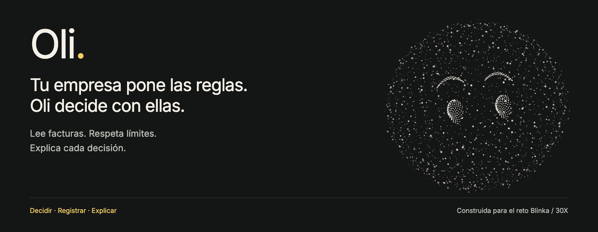
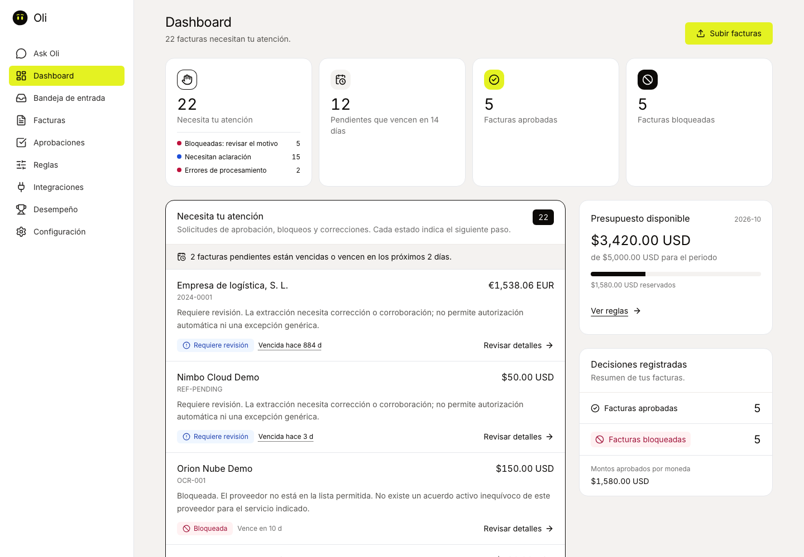
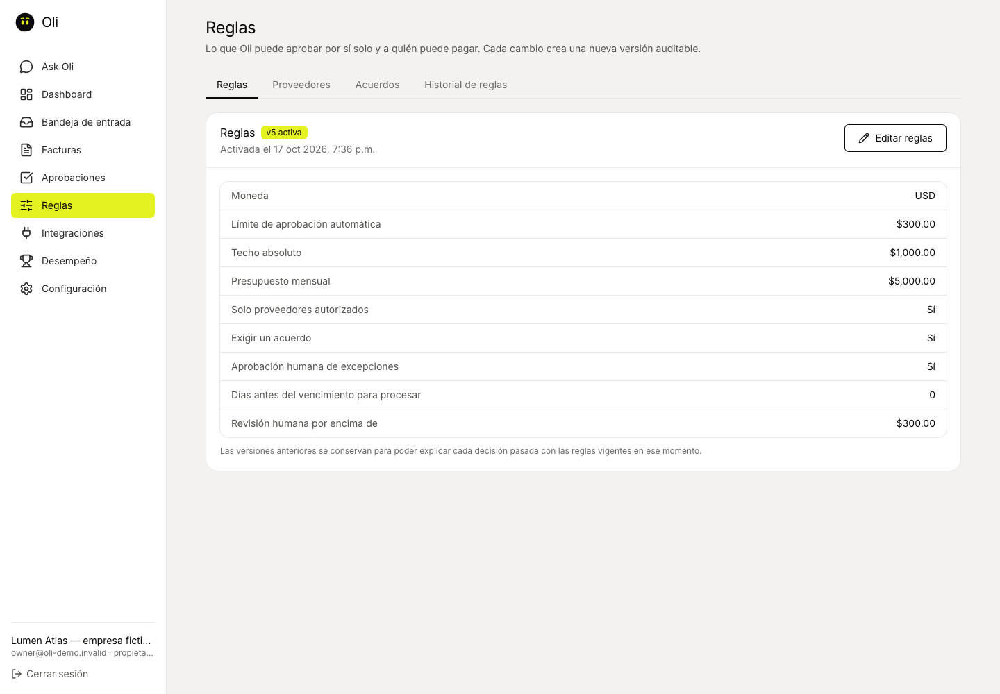
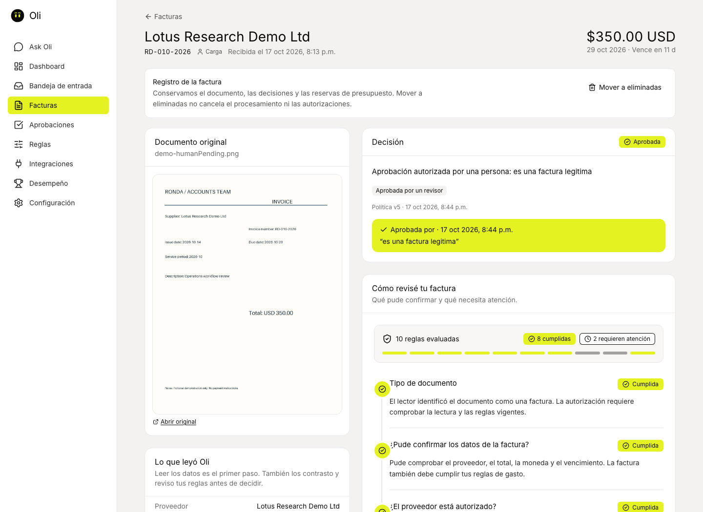
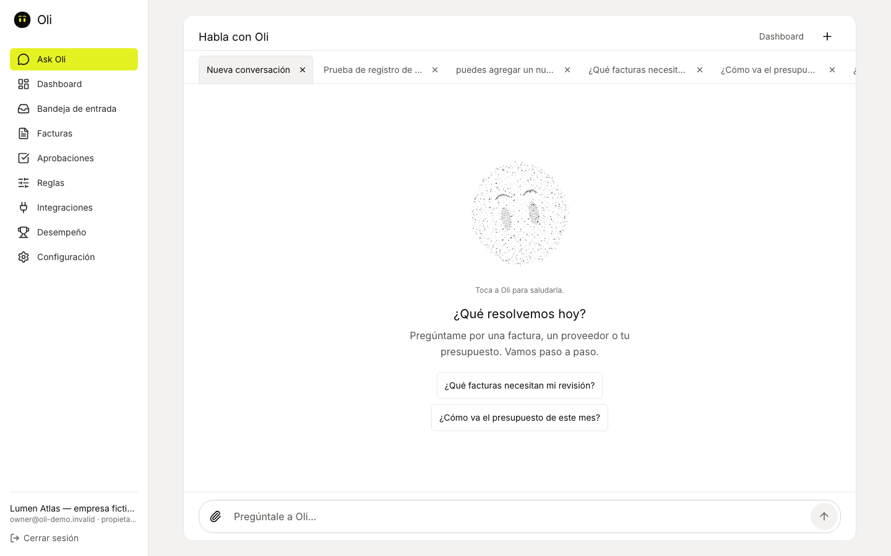
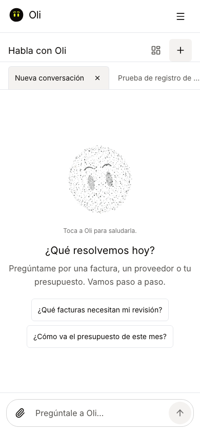
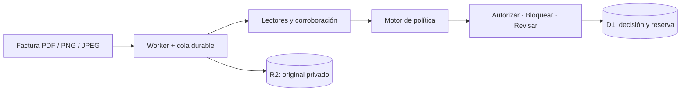
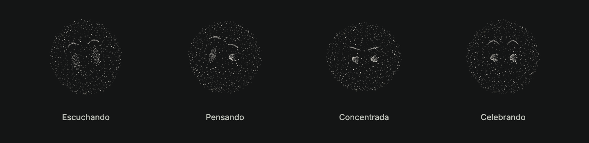

<p align="center">
  <a href="https://oli30x.ultramare.dev">
    <picture>
      <source media="(max-width: 600px)" srcset="docs/assets/readme/oli-portada-movil.png">
      
    </picture>
  </a>
</p>

<p align="center">
  <a href="https://oli30x.ultramare.dev"><strong>Conocer Oli</strong></a> ·
  <a href="#así-trabaja-oli">Ver el recorrido</a> ·
  <a href="#qué-medimos">Resultados y evidencia</a> ·
  <a href="#probar-en-local">Probar en local</a>
</p>

# De la factura a una decisión explicada

Oli es un agente de cuentas por pagar. Una empresa define sus proveedores, acuerdos y límites; Oli lee cada factura, contrasta la información y decide si puede autorizarla, debe frenarla o necesita que una persona intervenga. Cada decisión queda registrada con sus motivos y la política que la permitió.

Construida para el [reto Blinka de 30X](master_files/RETO_BLINKA.md). **Todas las empresas y facturas de esta demo son ficticias. Las autorizaciones y reservas son simuladas; Oli no mueve dinero.** El acceso a la aplicación publicada se facilita por un canal privado.



*Un lugar para saber qué está resuelto, qué necesita tu atención y cuánto presupuesto queda.*

## Así trabaja Oli

### Tu empresa define las reglas

El mandato establece cuánto puede autorizar Oli por sí sola, el techo absoluto por factura y el presupuesto del periodo. También define los proveedores permitidos, los acuerdos exigidos y las excepciones que una persona puede revisar. Los cambios crean versiones: una decisión pasada conserva las reglas con las que se tomó.



*Ejemplo de la cuenta demo: USD 300 de límite automático, USD 1.000 de techo y USD 5.000 de presupuesto mensual. Son valores configurables.*

### Oli lee, contrasta y decide

Puedes subir una factura en PDF, PNG o JPEG. El servidor conserva el original privado y coordina su lectura. Los campos críticos se contrastan antes de evaluar la política: recibir un JSON válido del modelo no basta para autorizar.

| Lo que encuentra Oli | Qué sucede |
| --- | --- |
| Lectura corroborada, proveedor y acuerdo válidos, importe dentro de los límites y presupuesto disponible | Puede autorizar automáticamente y registrar una reserva simulada. |
| Importe por encima del automático, dentro del techo y con las demás reglas cumplidas | Solicita una decisión humana. La aprobación vuelve a comprobar política y presupuesto. |
| Duplicado confirmado, proveedor no permitido o presupuesto insuficiente | Frena la autorización y registra el motivo. |
| Lectura incierta o datos que no coinciden | Solicita aclaración o revisión según el caso. La incertidumbre no permite autoaprobar. |

Repetir una petición conserva su resultado y evita reservar dos veces. Un error del proveedor de modelos tampoco se convierte en una autorización: los intentos tienen un límite.

### Cada decisión se puede entender después

En el detalle conviven el documento original, los datos leídos, las reglas evaluadas y la explicación. Una autorización humana conserva quién intervino y su justificación; procesamiento, decisión y revisión tienen registros separados.



*Esta factura superó el límite automático de USD 300 y fue autorizada por una persona. La pantalla distingue esa intervención de una aprobación automática.*

## También puedes hablar con Oli

Consulta facturas, proveedores y presupuesto desde una conversación. Puedes adjuntar documentos y revisar propuestas de cambios antes de confirmarlas. Las herramientas están acotadas y el servidor valida sus permisos; las decisiones financieras siguen pasando por el motor de política.



### Oli, también en el bolsillo

La misma aplicación se adapta al móvil para consultar cuentas, revisar el estado de las facturas y conversar con Oli.

<p align="center">
  
</p>

Además de la web, el proyecto incluye ingreso por [Telegram](docs/TELEGRAM.md), una [bandeja de correo](docs/EMAIL.md) y una [Oli Skill](apps/web/public/skills/oli/SKILL.md) para agentes con acceso limitado. Los canales comparten el flujo de procesamiento y sus controles: la entrada de un documento no concede autorización.

## Qué medimos

La evaluación final se ejecutó sobre **20 documentos ficticios de una empresa nueva, Ronda**, con lectores reales, API HTTP, cola, D1 y R2. Estos resultados pertenecen a esa muestra y a la versión identificada en el informe.

| Medida | Resultado observado |
| --- | --- |
| Decisiones completas correctas | **20 / 20** |
| Aprobaciones indebidas | **0 observadas** |
| Casos normales resueltos automáticamente | **8 / 8** |
| Autonomía correcta inicial | **15 / 20 · 75 %** |
| Decisiones con explicación y rastro | **20 / 20** |

**Decidir correctamente no significa leer todo perfectamente.** La exactitud literal de los ocho campos fue 16/20; las incertidumbres previstas permanecieron en revisión. La muestra cubre familias de formatos soportados y no demuestra lectura universal ni ausencia de errores futuros.

El [informe final](docs/evaluations/FINAL_CANDIDATE_20261017.md) conserva versiones, metodología, resultados originales y corridas anteriores con fallos. Las muestras usadas para corregir el sistema se identifican como regresiones. Las pruebas de contrato y D1 se reportan por separado de las métricas del extractor.

**Ver la demo grabada:** [escritorio](docs/evaluations/media/oli-desktop-20261018.webm) · [móvil](docs/evaluations/media/oli-mobile-20261018.webm) · [guion y evidencia de entrega](docs/ENTREGA_20261018.md).

## Cómo está construida



El Worker coordina el flujo. El motor puro de `packages/domain` evalúa la política; D1 registra las decisiones y crea la reserva de forma atómica al autorizar. El servidor calcula los hashes y la identidad de la evidencia. Las citas o la confianza del modelo no prueban exactitud por sí mismas.

| Capa | Implementación |
| --- | --- |
| Interfaz | React, TypeScript, Vite y Tailwind CSS |
| API y procesamiento | Cloudflare Workers y Queues |
| Persistencia | D1 para registros; R2 para documentos privados |
| Lectura | Modelos vía OpenRouter y corroboración independiente según el formato |
| Mascota | Canvas 2D de partículas, con renderer y wrapper React propios |

## Probar en local

Requiere **Node.js 22.18 o posterior**. Para explorar la interfaz con datos ficticios, desde la raíz del repositorio:

```sh
npm --prefix apps/web ci
npm --prefix apps/web run dev:mock
```

Abre `http://localhost:5173`. El modo mock permite recorrer la interfaz sin configurar servicios externos; sus respuestas ilustrativas no son una evaluación del backend.

Para el flujo conectado, sigue la [configuración local de la API](apps/api/README.md) y la [guía del frontend](apps/web/README.md). Necesitarás las dependencias de los paquetes enlazados y configurar D1, R2 y los secretos correspondientes. El despliegue requiere recursos propios de Cloudflare.

Las credenciales se guardan en archivos locales ignorados o secretos del Worker. **Cualquier variable `VITE_*` es pública** y se incorpora al frontend.

Con las dependencias de API instaladas, puedes ejecutar su suite local:

```sh
cd apps/api
node --test --test-concurrency=1 tests/*.test.mjs
```

Los proveedores se simulan en estas pruebas; sus resultados no son métricas OCR. Las evaluaciones con lectores reales están separadas, consumen servicios externos y conservan los fallos observados.

## Para explorar el proyecto

| Quiero entender… | Dónde empezar |
| --- | --- |
| El alcance y las restricciones del reto | [Reto Blinka](master_files/RETO_BLINKA.md) |
| Los endpoints y tipos compartidos | [Contrato HTTP](docs/API.md) · [Schemas](packages/contracts/README.md) |
| Las reglas de autorización | [Motor de política](packages/domain/README.md) |
| La lectura y sus garantías | [Extractores](packages/extraction/README.md) · [Seguridad de extracción](docs/EXTRACTION_SAFETY.md) |
| Los registros y las reservas | [Base de datos](packages/database/README.md) |
| Los casos ficticios y sus expectativas | [Fixtures de empresas](docs/fixtures/company-journey/README.md) |
| La mascota y sus estados | [Paquete Oli](packages/oli/README.md) |
| La preparación del repositorio público | [Publicación y saneamiento](docs/PUBLICACION.md) |

---



<p align="center"><strong>Decidir. Registrar. Explicar.</strong><br>Oli para el reto Blinka · Oscar y Whady</p>

<sub>Las capturas muestran la aplicación publicada el 18 de octubre de 2026 con datos de demostración; no representan una nueva corrida del benchmark. La portada y las expresiones se renderizaron con la mascota del proyecto. <a href="docs/assets/readme/README.md">Origen de las imágenes</a>.</sub>
